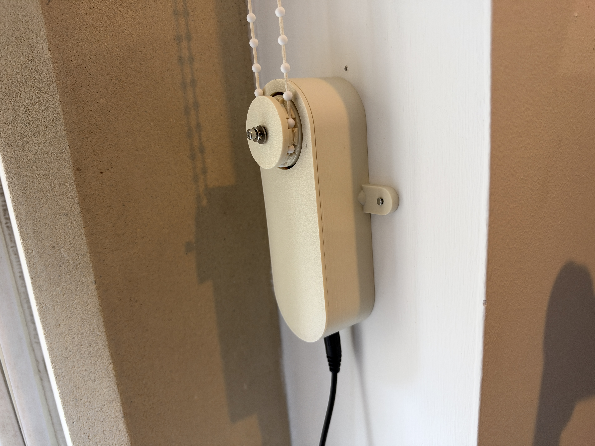

# ESP32 Roller Blind

A printed bead-chain blind motor with local web controls, encoder-based limits, saved schedules and wireless firmware updates. Built with an ESP32-C3 SuperMini, a JGY-370 12V/20RPM encoder motor and a DRV8871 driver.

## Start here

1. [Parts list / UK buying links](docs/BOM.md)
2. [Print and assemble](docs/ASSEMBLY.md)
3. [Wire the electronics](docs/WIRING.md)
4. [Install and configure firmware](docs/FIRMWARE.md)
5. [Calibrate, schedule and operate](docs/OPERATION.md)
6. [Troubleshooting](docs/TROUBLESHOOTING.md)
7. [Fusion CAD screenshot gallery](docs/CAD_GALLERY.md)

## What it does

- Raise, lower, stop and percentage position from a local webpage; no physical buttons.
- Encoder-based upper/lower calibration and endpoint command blocking.
- Fixed-time, sunrise/sunset and weekday schedules saved on the device.
- NTP clock with automatic UK GMT/BST; no Home Assistant required.
- Password-protected web firmware updates after the first USB install.
- Optional dashboard for up to eight blinds and eight groups, while each blind retains its own calibration/schedules.
- Continuous movement capped at 60 seconds, with missing/slow encoder feedback faults.

This is a hobby prototype. Software limits measure motor rotation; they do not detect chain slip, chain tension or obstructions. Supervise initial calibration and loaded tests. After every reboot, confirm the saved upper reference or recalibrate before automatic travel.

## Files

| Folder | Contents |
|---|---|
| [cad](cad/README.md) | V15 editable Fusion F3D, STEP and four print STLs |
| [firmware](firmware/README.md) | Arduino source, webpage source, tests and firmware 2.0.2 binaries |
| [docs](docs/ASSEMBLY.md) | BOM, build, wiring, setup, operation and troubleshooting |
| [docs/images](docs/images) | CAD views and photographs of the installed prototype |

The enclosure is approximately 50 × 140 mm without ears, 90 × 140 mm including the mounting ears, and 33.4 mm deep with the cover, excluding the wheel. The wheel uses the previously tested “0p5” bead geometry; that name does not specify a universal 0.5 mm bead pitch. Test your own chain before installing.

## The photographed build

SUNLU PLA+ 1.75 mm, 1 kg Bone White, printed on a Bambu Lab P1S using the Generic PLA filament preset and the 0.2 mm Strength process profile. The motor and DC socket were superglued into place; an M3 bolt and washer in the shaft-end thread retain the gear. Exact preset version, orientation, support choices, glue brand, bolt length and washer dimensions have not been recorded. The supplied files are STL/CAD, not a prepared Bambu 3MF print project.

## Credits and licence

Adapted from [nik-po/nik.po-roller-blind](https://github.com/nik-po/nik.po-roller-blind) and the author's linked [MakerWorld mechanical design](https://makerworld.com/en/models/3292116-smart-roller-blind-motor-esp32-home-assistant). This version adds a revised measured motor/wheel fit, flush glue-mounted DC jack, exposed mounting ears, blank button-free cover and a custom Arduino controller.

See [ATTRIBUTION.md](ATTRIBUTION.md) and [LICENSE.md](LICENSE.md). The project is shared under **CC BY-NC-SA 4.0**: attribution, noncommercial use and share-alike. Third-party libraries retain their own licences. There is no claim of endorsement by the original author.

No Wi-Fi passwords, administrator password, pairing keys or private device logs are included. Set your own credentials during installation.
