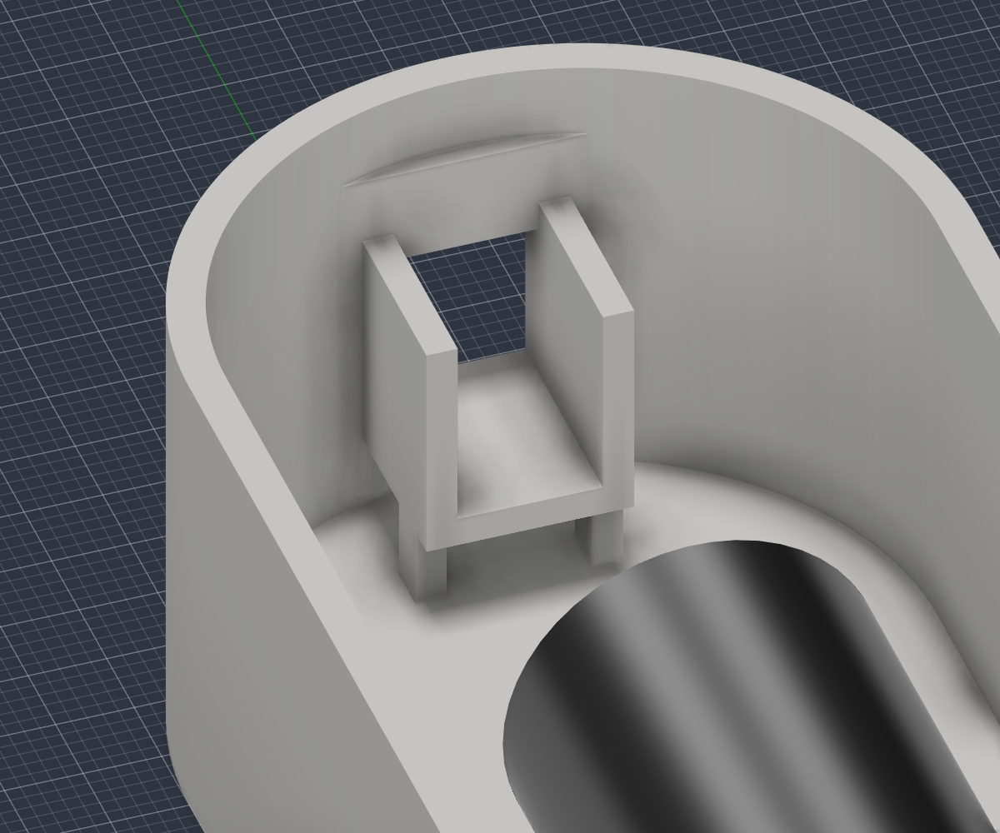
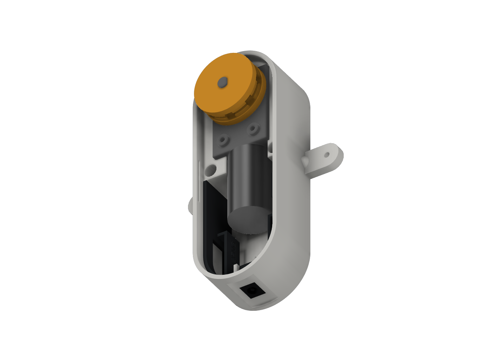
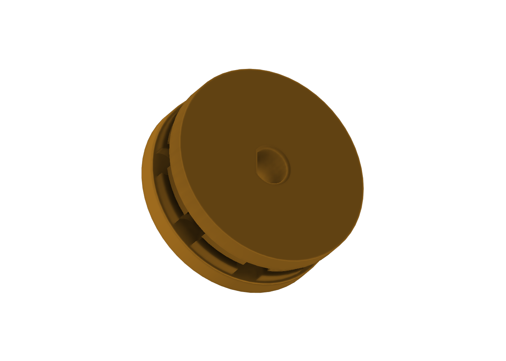
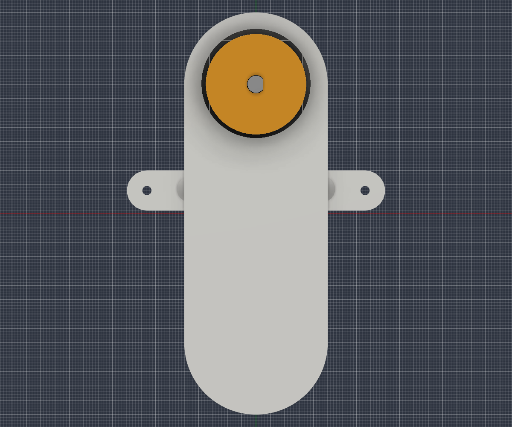
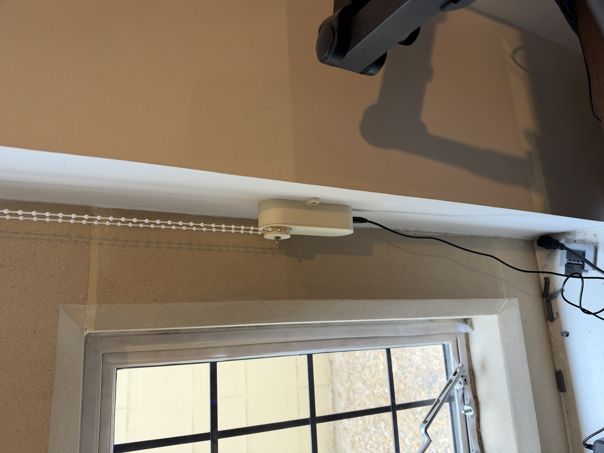
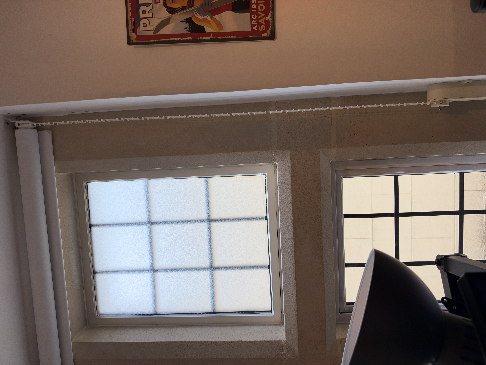

# Print and assemble

## 1. Check your blind and parts

Check the actual motor, shaft and socket against [BOM measurements](BOM.md). Match the wheel to your bead chain: the builder’s tested chain is not a universal standard. Confirm the chain connector can travel through the wheel path without jamming. Plan a secure mounting position and retain the blind’s appropriate chain safety/tension arrangement.

## 2. Print

Use the four [V15 STL files](../cad/stl/). The photographed build used:

| Setting | Builder-reported value |
|---|---|
| Printer | Bambu Lab P1S |
| Filament | SUNLU PLA+ 1.75mm, Bone White |
| Filament preset | Generic PLA |
| Process preset | 0.2mm Strength |

Exact nozzle size, temperatures, infill, wall count, support settings, plate type and preset version were not supplied. Use your installed profile as the starting point and inspect the slicer preview. The STLs are not a ready-to-print 3MF. Inspect support/bridging beneath the jack cradle and orient the wheel to preserve its bead pockets and shaft fit. Remove support and burrs without altering bead grip. PLA+ can soften in a hot window; the prototype is not a temperature-qualified product.

Dry-fit the wheel before assembling the case. It should fit the D-shaft without excessive force or splitting. The small bore-entry chamfer helps insertion, but does not compensate for inaccurate printing. Check the chain against a wheel test print before committing to installation.

## 3. Fit the DC jack

*Socket and carrier hidden to show the glue cradle.*

With the cover removed, dry-fit the measured socket into the open-top U cradle at the bottom end of the housing. Align the socket’s front face with the flat outer landing. Check the solder tabs clear the insert and cover. The nominal cradle is 9.22 × 11.04 × 14.11mm; the reference CAD socket is an envelope, not a manufacturer model.

The builder used superglue (cyanoacrylate) to fix the DC socket into its cradle. Keep glue out of the electrical contacts and plug bore, hold the front face flush, and allow the glue to cure fully. The exact glue brand was not recorded. Provide internal cable strain relief rather than relying on the glue joint to resist repeated pulling.

## 4. Install motor and boards

*Motor and carrier reference layout; the builder superglued the motor in place.*

The builder superglued the motor to the case because this was easier than fitting gearbox mounting screws. Dry-fit and align the motor and electronics insert first, then glue the stationary motor/gearbox housing to the case. Keep adhesive away from the shaft, moving parts and motor openings; hold alignment until fully cured. No gearbox mounting screws were used in this build. Check the cover closes without trapping cables. Insulate board undersides and exposed joints. Secure boards so they cannot rattle into the motor or socket. Do not cover the ESP antenna with metal or place loose wires in the chain path.

Follow [WIRING.md](WIRING.md), then install firmware and test encoder feedback before putting the wheel on the blind chain. The Mini360 must be adjusted and measured before powering the ESP.

## 5. Wheel and cover

*The separate M3 bolt and washer used for retention are not shown in the CAD.*

Fit the wheel onto the D-shaft. The builder confirmed an M3 threaded hole in the end of the motor shaft and used an M3 bolt with a washer to keep the gear from coming off. The shaft’s external diameter is still nominally 6mm; M3 describes the retention thread, not the shaft diameter. Choose a bolt length that engages the thread without bottoming out, and a washer that retains the wheel. Tighten gently without crushing the printed hub or loading the shaft excessively. The exact bolt length and washer dimensions were not recorded. Check the wheel rotates freely, chain seats in the pockets, and the case/cover do not rub. There are no physical buttons in V15.

## 6. Mount

The external ears use two Ø3.2mm holes spaced 76mm apart. Select fasteners for the actual surface, with shafts that clear the holes and heads that retain the ears. Do not hammer through a motor/electronics enclosure or strike the printed ears. Use a gentle final seating method; the prototype has no tested mounting load rating. Secure the housing against twisting so chain tension cannot pull it sideways.

## 7. Commission

Run a motor-off-chain startup/reset test, verify direction and encoder counts, then attach the chain and calibrate while supervising. Test both limits repeatedly under load, Stop, power-loss recovery and a schedule a few minutes ahead. Do not enable unattended schedules until these tests pass. See [OPERATION.md](OPERATION.md).

See the [full Fusion CAD gallery](CAD_GALLERY.md) for the assembly and side profile.
