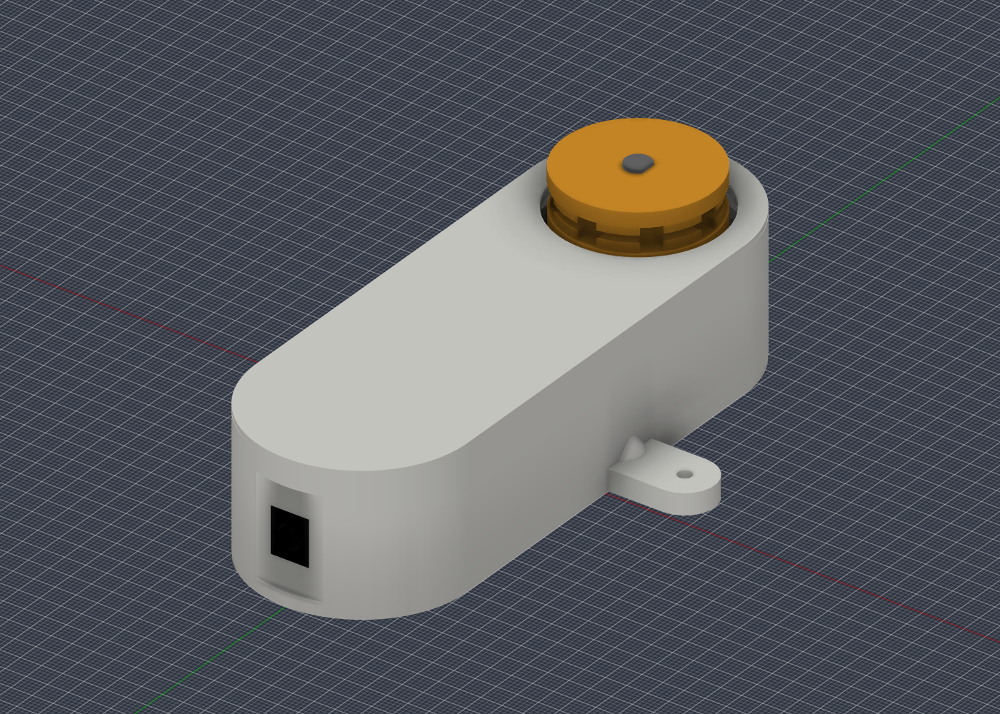
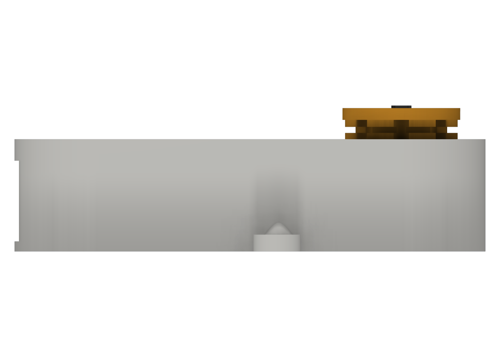

# Fusion CAD gallery — V15

These six images are exported directly from the saved V15 Fusion model. They illustrate the supplied CAD; colours and motor/jack reference shapes are for visual identification, not a claim that all electronic components are modelled in full detail. See [the CAD downloads](../cad/README.md) and [assembly guide](ASSEMBLY.md).

## 1. Complete assembly

Blank cover, bead wheel, flush DC inlet and external mounting ear.

## 2. External wall mounts

Both mounting ears are visible. Their holes are 3.2mm diameter and 76mm between centres.

## 3. Cover removed

Motor reference, wheel and internal carrier positions. The gearbox still has its original mounting holes in the CAD; the photographed builder fixed the motor with superglue instead of gearbox screws.

## 4. DC socket glue cradle

Cover, carrier and socket reference are hidden to expose the cradle. Fit the actual socket from inside, align its front face flush with the outside landing and superglue it into position. Keep glue out of the contacts.

## 5. Wheel shaft opening

Isolated wheel viewed from underneath, showing the D-shaped opening, entry chamfer and bead pockets around the rim. The M3 retaining bolt and washer used in the physical build are not modelled here. The CAD bore is 6.30mm round / 5.60mm across the flat, with a 0.5mm entry chamfer; actual printed fit varies.

## 6. Side profile

The assembled case and wheel projection. Assembled case depth is 33.4mm excluding the wheel; the standard case footprint is 50 × 140mm, increasing to 90 × 140mm across the ears.

