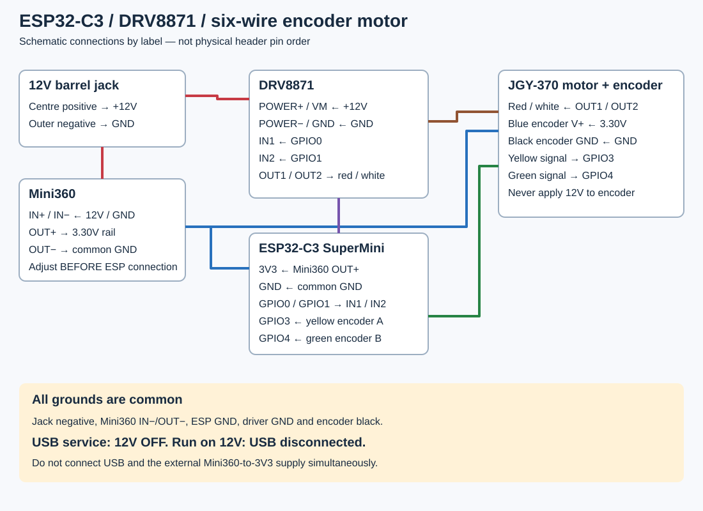

# Wiring — current GPIO0/1 DRV8871 build

Use printed board labels, not assumed physical header order. **Switch all power off before changing wiring. Never connect USB while the Mini360 feeds the ESP’s 3V3 pin.**

| From | To |
|---|---|
| DC jack centre-positive +12V | DRV8871 POWER+ / VM and Mini360 IN+ |
| DC jack negative | DRV8871 POWER− / GND and Mini360 IN− |
| Mini360 OUT+, adjusted to 3.3V | ESP 3V3 and encoder blue |
| Mini360 OUT− | ESP GND and encoder black; common ground with driver |
| ESP GPIO0 | DRV8871 IN1 |
| ESP GPIO1 | DRV8871 IN2 |
| DRV8871 motor OUT1 | Motor red |
| DRV8871 motor OUT2 | Motor white |
| Encoder yellow | ESP GPIO3 |
| Encoder green | ESP GPIO4 |

The six-wire colour mapping worked after the builder corrected the encoder connections. It is specific to the selected motor/harness; check the seller’s pinout if yours differs. Swapping yellow/green reverses count direction, not whether pulses are present. Calibration determines the count sign.

## Set the Mini360

With ESP and encoder disconnected, supply the converter with 12V and measure OUT+ relative to OUT−. Adjust the trimmer to **3.30V**. Switch off before connecting loads. Recheck at the ESP pins and encoder blue/black under load. Brief Wi-Fi dips can be missed by an ordinary meter. Do not compensate for bad wiring by increasing output voltage.

## Power and service

- Run mode: external 12V, USB disconnected.
- USB service: 12V off/disconnected. USB powers the controller; it does not power the 12V motor.
- Never apply 12V to the ESP, encoder signal pins or 3V3 rail.
- VM is the driver’s motor supply, not a 3.3V logic VCC connection. This DRV8871 board has no separate STBY/PWMA or VCC wiring.
- Use GPIO0/1 for this firmware. Historical GPIO7/6 and TB6612 diagrams do not apply.
- Check jack polarity/terminal identity with a meter; a socket’s third switched contact is not automatically ground.
- Keep solder joints insulated and provide strain relief. Check the actual driver’s current-limit resistor; an advertised peak current is not a continuous rating.

Initial tests should use current limiting with the motor off the chain. The driver IC reference is [TI DRV8871 datasheet](https://www.ti.com/lit/ds/symlink/drv8871.pdf).
