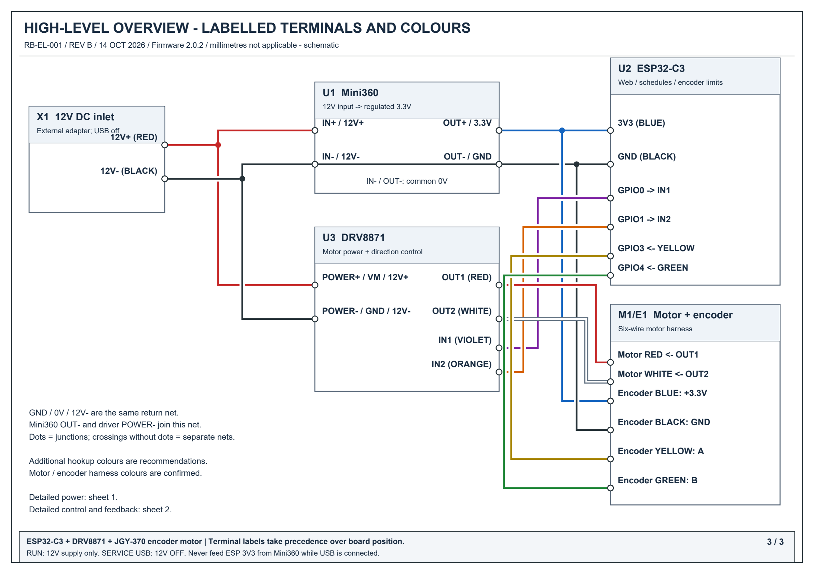
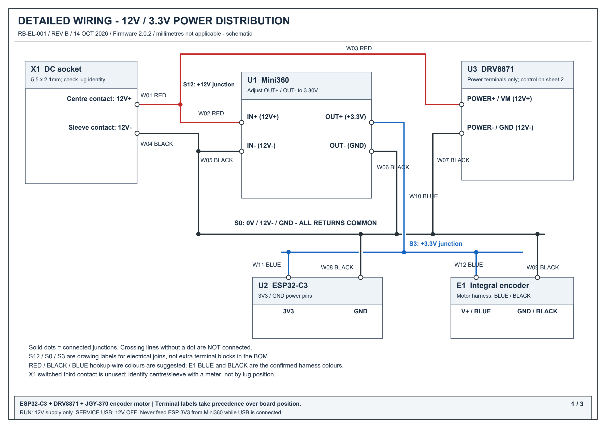
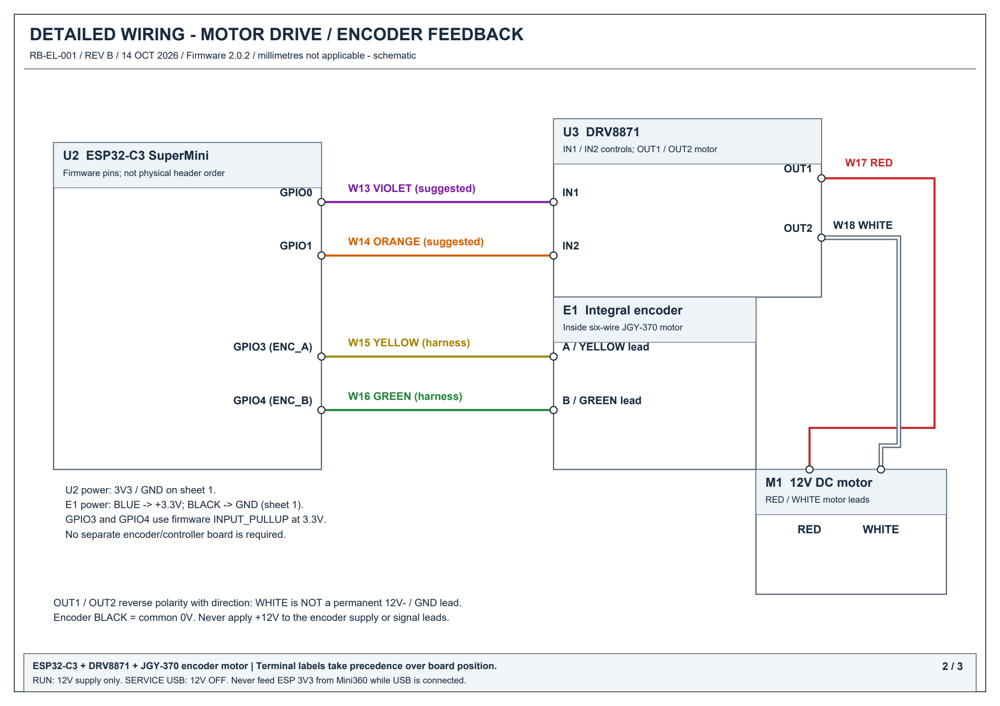

# Wiring — detailed terminal drawings and overview

Current build: **firmware 2.0.2, ESP32-C3, DRV8871, six-wire JGY-370 motor, Mini360**. Use printed terminal labels, not assumed physical header positions. Switch all power off before changing wiring. **Never connect USB while the Mini360 feeds the ESP’s 3V3 pin.**

[Download the three-page A3 PDF drawing pack](Blind_Wiring_Drawings.pdf) · [Download the terminal wire list CSV](WIRE_LIST.csv)

## High-level overview

Shows the complete system with named terminals: 12V+ / 12V-, IN+ / IN-, OUT+ / OUT-, 3V3 / GND, GPIO0 / GPIO1, GPIO3 / GPIO4, IN1 / IN2 and motor OUT1 / OUT2.

[Vector SVG](images/wiring_overview.svg)

## Detailed sheet 1 — power distribution

Each conductor has an ID. All 0V returns join S0; the 12V+ supply and regulated 3.3V rail remain separate. Solid dots indicate connected junctions. Crossing lines without a dot are not connected.

[Vector SVG](images/wiring_power.svg)

## Detailed sheet 2 — motor and encoder

GPIO0 goes to IN1; GPIO1 goes to IN2. Encoder YELLOW goes to GPIO3 and GREEN to GPIO4. Motor RED goes to OUT1 and WHITE to OUT2. The encoder's BLUE / BLACK supply connections are on sheet 1.

[Vector SVG](images/wiring_signals.svg)

## Wire colours: confirmed versus suggested

The motor harness colours **RED, WHITE, BLUE, BLACK, YELLOW and GREEN** are the working mapping reported for this build. Additional hookup-wire colours were not recorded; the drawings use the following recommended scheme:

- RED: fixed +12V supply.
- BLACK: common 0V / 12V- / GND.
- BLUE: regulated +3.3V.
- VIOLET: GPIO0 to IN1.
- ORANGE: GPIO1 to IN2.

**Motor WHITE is an H-bridge output, not a permanent 12V- / GND wire.** Motor RED is also an H-bridge output; it is not connected directly to the fixed +12V rail. OUT1 / OUT2 reverse polarity with direction. Connect by terminal and net name, not colour alone.

The six-wire harness mapping is specific to the selected motor. Check its pinout if yours differs. Swapping YELLOW / GREEN reverses counting direction; calibration determines the count sign. BLUE powers the encoder at 3.3V and BLACK returns to common GND; never apply +12V to encoder power or signal leads.

## Device and junction identifiers

| Drawing tag | Physical item / meaning |
|---|---|
| X1 | Female DC barrel socket: centre contact 12V+, sleeve 12V-; switched third lug unused |
| U1 | Mini360 buck converter: IN+, IN-, OUT+, OUT- |
| U2 | ESP32-C3 SuperMini: 3V3, GND, GPIO0, GPIO1, GPIO3, GPIO4 |
| U3 | DRV8871 breakout: POWER+ / VM, POWER- / GND, IN1, IN2, OUT1, OUT2 |
| M1 | Motor winding: RED and WHITE wires |
| E1 | Encoder integral to M1: BLUE supply, BLACK return, YELLOW A, GREEN B |
| S12 | Electrical junction for fixed +12V |
| S0 | Electrical junction for common 0V / 12V- / GND |
| S3 | Electrical junction for regulated +3.3V |

S12 / S0 / S3 represent soldered joins or equivalent same-net wiring, not added terminal blocks. E1 is part of the motor, not another board to buy. The drawing is a connection schematic rather than a to-scale board pin-layout drawing. Use board silkscreen labels and confirm DC socket lug identity with a meter.

## Complete point-to-point wire list

| Wire ID | From terminal | To terminal | Colour | Colour basis | Electrical net |
|---|---|---|---|---|---|
| W01 | X1 centre (+12V) | S12 | RED | suggested | +12V |
| W02 | S12 | U1 IN+ | RED | suggested | +12V |
| W03 | S12 | U3 POWER+ / VM | RED | suggested | +12V |
| W04 | X1 sleeve (12V-) | S0 | BLACK | suggested | 0V |
| W05 | S0 | U1 IN- | BLACK | suggested | 0V |
| W06 | S0 | U1 OUT- | BLACK | suggested | 0V |
| W07 | S0 | U3 POWER- / GND | BLACK | suggested | 0V |
| W08 | S0 | U2 GND | BLACK | suggested | 0V |
| W09 | S0 | E1 GND / BLACK lead | BLACK | motor harness | 0V |
| W10 | U1 OUT+ (+3.3V) | S3 | BLUE | suggested | +3.3V |
| W11 | S3 | U2 3V3 | BLUE | suggested | +3.3V |
| W12 | S3 | E1 V+ / BLUE lead | BLUE | motor harness | +3.3V |
| W13 | U2 GPIO0 | U3 IN1 | VIOLET | suggested | IN1 |
| W14 | U2 GPIO1 | U3 IN2 | ORANGE | suggested | IN2 |
| W15 | E1 A / YELLOW lead | U2 GPIO3 | YELLOW | motor harness | ENC_A |
| W16 | E1 B / GREEN lead | U2 GPIO4 | GREEN | motor harness | ENC_B |
| W17 | U3 OUT1 | M1 RED lead | RED | motor harness | MOTOR_A |
| W18 | U3 OUT2 | M1 WHITE lead | WHITE | motor harness | MOTOR_B |

## Set the Mini360

With ESP and encoder disconnected, supply the converter with 12V and measure OUT+ relative to OUT−. Adjust the trimmer to **3.30V**. Switch off before connecting loads. Recheck at the ESP pins and encoder blue/black under load. Brief Wi-Fi dips can be missed by an ordinary meter. Do not compensate for bad wiring by increasing output voltage.

## Power and service

- Run mode: external 12V, USB disconnected.
- USB service: 12V off/disconnected. USB powers the controller; it does not power the 12V motor.
- Never apply 12V to the ESP, encoder signal pins or 3V3 rail.
- VM is the driver’s motor supply, not a 3.3V logic VCC connection. This DRV8871 board has no separate STBY/PWMA or VCC wiring.
- Use GPIO0/1 for this firmware. Historical GPIO7/6 and TB6612 diagrams do not apply.
- Check jack polarity/terminal identity with a meter; a socket’s third switched contact is not automatically ground.
- Keep solder joints insulated and provide strain relief. Check the actual driver’s current-limit resistor; an advertised peak current is not a continuous rating.

Initial tests should use current limiting with the motor off the chain. The driver IC reference is [TI DRV8871 datasheet](https://www.ti.com/lit/ds/symlink/drv8871.pdf).
